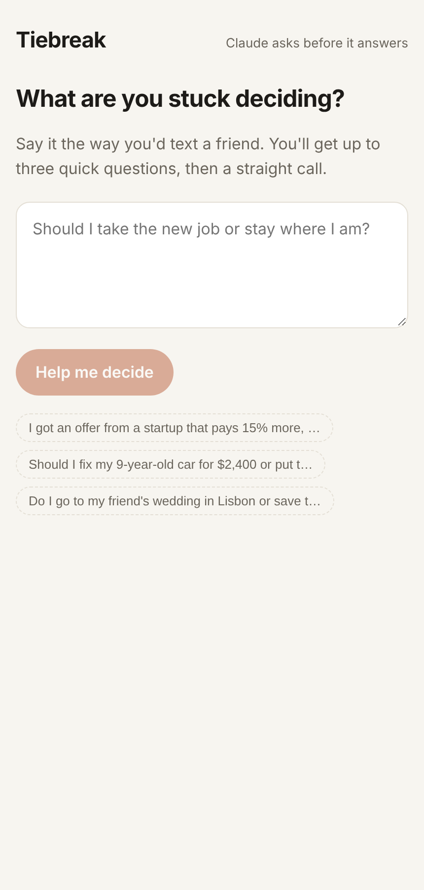
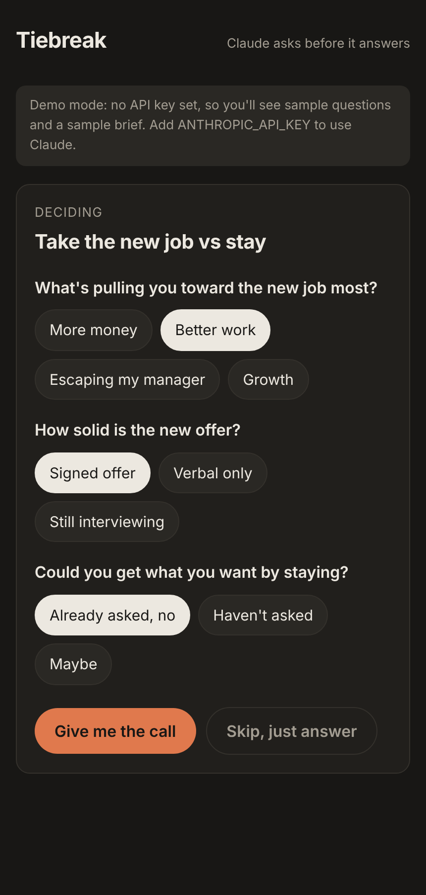
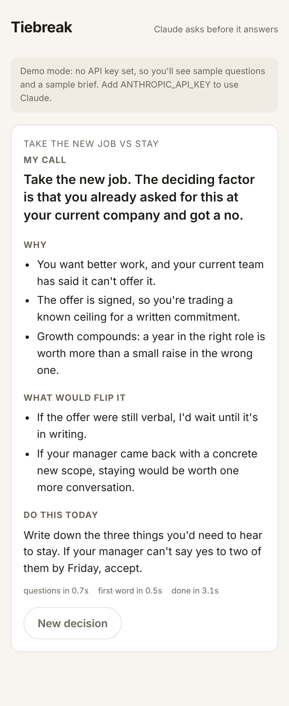

# Tiebreak

**Claude asks before it answers.** Describe a decision you're stuck on, answer up to three one-tap questions, and get a one-screen brief that commits to a call.

- `MEMO.md`: the one-page bet (the gap, why now, the cheapest test)
- Built with Next.js (App Router) and TypeScript on the public Claude API, with streaming

| Ask | Clarify | Brief |
|---|---|---|
|  |  |  |

## How it works

1. **`POST /api/clarify`**: one call with structured outputs (a Zod schema) at low effort. It returns a short decision label, the options, and at most three questions, each with 2–4 tappable answers. If nothing is ambiguous, it returns zero questions and the app goes straight to the brief.
2. **`POST /api/decide`**: streams the brief as plain text in a fixed four-section contract (*My call / Why / What would flip it / Do this today*, under 170 words). It uses server-side refusal fallbacks and aborts the upstream stream if the user leaves.
3. **The client** renders the stream with a 50-line markdown renderer (no markdown library in the bundle) and shows measured timings: questions in, first word in, done in.

The prompt contracts live in `lib/prompts.ts`.

## Run it

```bash
npm install
cp .env.example .env.local   # add ANTHROPIC_API_KEY
npm run dev
```

With no key set, the app runs in **demo mode**, with canned questions and a canned brief streamed at a realistic pace, so you can click through the UX for free.

## Deploy

Works on Vercel as is. Set `ANTHROPIC_API_KEY` in the project's environment variables.
